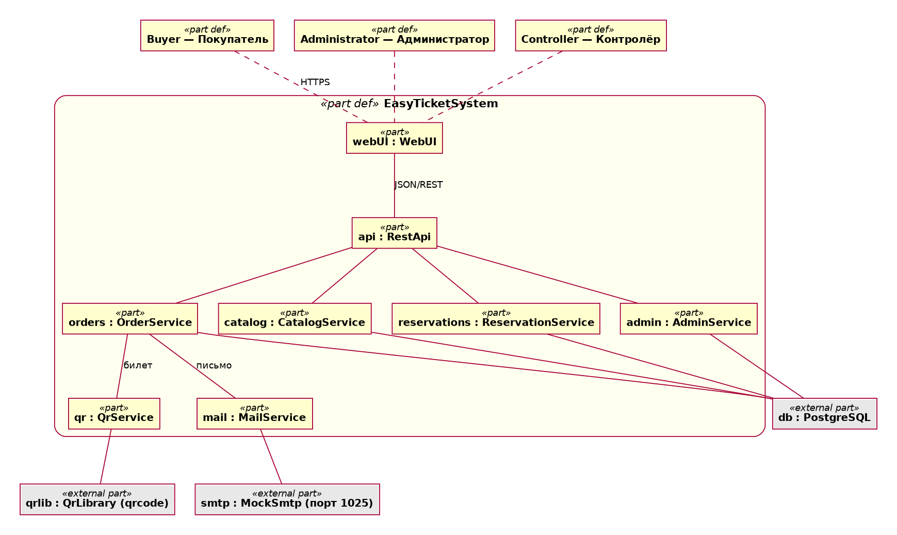

# Спецификация требований к ПО

Для системы бронирования билетов «EasyTicket»

Версия 0.1

Подготовил(а) Питковский В.В.

БГУИР, группа 439401

25.10.2026

## Оглавление

<!-- TOC -->
* [1. Введение](#1-introduction)
  * [1.1 Назначение документа](#11-document-purpose)
  * [1.2 Область применения продукта](#12-product-scope)
  * [1.3 Определения, акронимы и сокращения](#13-definitions-acronyms-and-abbreviations)
  * [1.4 Ссылки](#14-references)
  * [1.5 Обзор документа](#15-document-overview)
* [2. Обзор продукта](#2-product-overview)
  * [2.1 Перспектива продукта](#21-product-perspective)
  * [2.2 Функции продукта](#22-product-functions)
  * [2.3 Ограничения продукта](#23-product-constraints)
  * [2.4 Характеристики пользователей](#24-user-characteristics)
  * [2.5 Допущения и зависимости](#25-assumptions-and-dependencies)
  * [2.6 Распределение требований](#26-apportioning-of-requirements)
* [3. Требования](#3-requirements)
  * [3.1 Внешние интерфейсы](#31-external-interfaces)
    * [3.1.1 Пользовательские интерфейсы](#311-user-interfaces)
    * [3.1.2 Аппаратные интерфейсы](#312-hardware-interfaces)
    * [3.1.3 Программные интерфейсы](#313-software-interfaces)
  * [3.2 Функциональные требования](#32-functional)
  * [3.3 Качество обслуживания](#33-quality-of-service)
    * [3.3.1 Производительность](#331-performance)
    * [3.3.2 Безопасность](#332-security)
    * [3.3.3 Надёжность](#333-reliability)
    * [3.3.4 Доступность](#334-availability)
    * [3.3.5 Наблюдаемость](#335-observability)
  * [3.4 Соответствие стандартам](#34-compliance)
  * [3.5 Проектирование и реализация](#35-design-and-implementation)
    * [3.5.1 Установка](#351-installation)
    * [3.5.2 Сборка и поставка](#352-build-and-delivery)
    * [3.5.3 Распределение](#353-distribution)
    * [3.5.4 Сопровождаемость](#354-maintainability)
    * [3.5.5 Повторное использование](#355-reusability)
    * [3.5.6 Переносимость](#356-portability)
    * [3.5.7 Стоимость](#357-cost)
    * [3.5.8 Сроки](#358-deadline)
    * [3.5.9 Доказательство концепции](#359-proof-of-concept)
    * [3.5.10 Управление изменениями](#3510-change-management)
  * [3.6 ИИ/МО](#36-aiml)
* [4. Верификация](#4-verification)
* [5. Приложения](#5-appendixes)
<!-- TOC -->

## История изменений

| Name | Date | Reason For Changes | Version |
|------|------|--------------------|---------|
| Питковский В.В. | 25.10.2026 | Первоначальная версия по результатам интервью с Заказчиком | 0.1 |
|      |      |                    |         |

---

## 1. Введение {#1-introduction}

Документ определяет требования к системе бронирования билетов «EasyTicket» версии 0.1: web-приложению, позволяющему покупателям выбирать места на схеме зала, временно резервировать их, оформлять заказ и получать электронный билет с QR-кодом на email, а администраторам и контролёрам — управлять мероприятиями и проверять билеты. Документ предназначен для заказчика, разработчиков и тестировщиков. Детали требований приведены в разделе 3.

### 1.1 Назначение документа {#11-document-purpose}

SRS определяет, **ЧТО** должна делать система «EasyTicket», а не **КАК** она будет реализована. Заказчик использует документ для согласования функциональности, разработчики — для проектирования и реализации, тестировщики — для построения тест-кейсов и матрицы верификации (раздел 4), преподаватель — для оценки полноты и качества требований в рамках курса «Жизненный цикл разработки программного обеспечения».

Документ является основой для последующих лабораторных работ курса (проектирование, реализация, тестирование) и ведётся в репозитории проекта в системе контроля версий.

### 1.2 Область применения продукта {#12-product-scope}

**Продукт:** web-приложение «EasyTicket», версия 0.1.

**Назначение:** автоматизировать продажу билетов на мероприятия небольших театров и концертных залов с выбором конкретного места, исключить двойную продажу одного места и сократить ручной учёт и очереди в кассе.

**Бизнес-цели:**
- исключить продажу одного места двум покупателям;
- дать покупателю возможность купить билет в любое время без обращения в кассу;
- обеспечить быструю проверку подлинности билета на входе по QR-коду;
- дать администратору зала актуальную статистику продаж.

**Ключевые возможности:**
- каталог мероприятий с фильтрацией по дате, жанру и цене;
- интерактивная схема зала со статусами мест;
- временное резервирование выбранных мест на 10 минут;
- оформление заказа по email с эмуляцией оплаты;
- генерация подписанного QR-кода и отправка электронного билета на email;
- проверка билета по QR-коду на входе;
- панель администратора: управление мероприятиями, статистика, отмена броней.

**Границы (что НЕ входит в версию 0.1):**
- реальная оплата через платёжные системы (оплата эмулируется);
- возврат билетов (выполняется через кассу);
- продажа сопутствующих товаров (еда, напитки, сувениры);
- агрегация мероприятий сторонних организаторов;
- мобильное приложение (только web, в том числе страница проверки билета для смартфона);
- регистрация и личные кабинеты покупателей;
- функции «Добавить в календарь» и «Поделиться», а также разделы панели администратора «Клиенты», «Отчёты» и «Настройки», (отложены, см. 2.6).

### 1.3 Определения, акронимы и сокращения {#13-definitions-acronyms-and-abbreviations}

| Term | Definition |
|------|------------|
| API | Application Programming Interface — набор определений и протоколов для создания и интеграции прикладного ПО |
| BYN | Белорусский рубль — валюта расчётов в системе |
| HMAC | Hash-based Message Authentication Code — код аутентификации сообщения на основе хеш-функции, используется для подписи QR-кода |
| Mock SMTP | Тестовый SMTP-сервер, принимающий письма без реальной доставки адресатам |
| MVP | Minimum Viable Product — минимально жизнеспособный продукт |
| QR-код | Quick Response Code — двумерный штрих-код для быстрого считывания информации |
| REST | Representational State Transfer — стиль построения веб-API |
| SMTP | Simple Mail Transfer Protocol — протокол передачи электронной почты |
| SRS | Software Requirements Specification — документ, описывающий назначение, требования и характер ПО |
| UI | User Interface — визуальная часть приложения, через которую пользователь взаимодействует с ПО |
| Администратор | Сотрудник зала, управляющий мероприятиями и просматривающий статистику |
| Бронь | Временное закрепление места за покупателем на ограниченный срок до оплаты |
| Заказ | Набор мест одного мероприятия, оформленный на один email, с уникальным идентификатором |
| Контролёр | Сотрудник, проверяющий билеты на входе |
| Мероприятие | Спектакль, концерт или иное событие, на которое продаются билеты |
| Овербукинг | Продажа одного и того же места более чем одному покупателю |
| Покупатель | Посетитель сайта, оформляющий заказ на билеты |

### 1.4 Ссылки {#14-references}

| Ссылка | Тип | Расположение |
|--------|-----|--------------|
| Лабораторная работа №3 «Разработка и документирование бизнес-требований», БГУИР | Справочная | Методические материалы курса |
| IEEE 830-1998. Recommended Practice for Software Requirements Specifications | Справочная | Стандарт IEEE |
| ISO/IEC 18004. QR Code bar code symbology specification | Нормативная | Стандарт ISO/IEC |
| RFC 5321. Simple Mail Transfer Protocol | Нормативная | Стандарт IETF |
| RFC 5322. Internet Message Format | Нормативная | Стандарт IETF |
| WCAG 2.1. Web Content Accessibility Guidelines | Справочная | W3C |
| Документация библиотеки qrcode | Справочная | Документация библиотеки |
| Модель системы на SysML v2 и диаграммы | Справочная | `srs/model/easyticket.sysml`, `srs/diagrams/G1_system_structure.png` (см. приложение Г) |

### 1.5 Обзор документа {#15-document-overview}

Раздел 1 содержит назначение документа и границы продукта. Раздел 2 описывает контекст продукта, его функции, ограничения, пользователей, допущения и распределение требований. Раздел 3 содержит верифицируемые требования: интерфейсы, функциональные требования, качество обслуживания, соответствие стандартам и ограничения реализации. Раздел 4 — матрица верификации. Раздел 5 — приложения (модель экранов, примеры данных, протокол интервью, модель и диаграммы SysML v2).

Соглашения: ключевые слова «должен» — обязательное требование, «следует» — рекомендуемое, «может» — необязательное. Идентификаторы требований имеют вид `REQ-[AREA]-[NNN]`. История изменений ведётся в таблице в начале документа; изменения вносятся через pull-request с ревью.

---

## 2. Обзор продукта {#2-product-overview}

### 2.1 Перспектива продукта {#21-product-perspective}

«EasyTicket» — новое самостоятельное web-приложение для небольших театров и концертных залов, которым не нужны сложные и дорогие системы продажи билетов. Продукт не заменяет существующую систему и не является частью более крупной, но использует внешние компоненты: библиотеку генерации QR-кодов, SMTP-сервер для отправки писем и реляционную базу данных.

Контекст системы:

```
Покупатель ──► [Web-интерфейс] ──► [REST API EasyTicket] ──► [PostgreSQL]
Администратор ─►                          │
Контролёр ─────►                          ├──► [Библиотека qrcode]
                                          └──► [Mock SMTP] ──► (письмо с билетом)
```

Владелец продукта — Заказчик (роль организатора мероприятий); разработка и сопровождение в рамках учебного проекта выполняются автором документа. Формальные SLA не предусмотрены.

### 2.2 Функции продукта {#22-product-functions}

1. **Каталог мероприятий** — список предстоящих событий с фильтрацией по дате, жанру и цене и сортировкой.
2. **Информация о мероприятии и схема зала** — описание, дата, место, цены и интерактивная схема с цветовой индикацией статусов мест.
3. **Корзина и временное резервирование** — выбор нескольких мест; на время оформления места закрепляются за покупателем на 10 минут.
4. **Оформление заказа** — ввод email, подтверждение заказа (оплата эмулируется), присвоение номера заказа.
5. **Электронный билет** — генерация подписанного QR-кода, отправка билета на email, повторный просмотр билета по номеру заказа и email.
6. **Проверка билета на входе** — проверка подлинности билета и однократность прохода по QR-коду.
7. **Администрирование** — вход администратора, создание/изменение/удаление мероприятий, статистика продаж, отмена броней.

### 2.3 Ограничения продукта {#23-product-constraints}

- Система должна работать в современных браузерах (Chrome, Firefox, Safari, Edge — две последние мажорные версии).
- Для генерации QR-кодов система должна использовать библиотеку qrcode.
- Отправка писем в среде разработки и тестирования должна выполняться через mock SMTP-сервер.
- Время жизни брони не должно превышать 10 минут.
- Система не должна хранить платёжные данные покупателей; оплата в версии 0.1 эмулируется.
- Данные системы должны храниться в реляционной базе данных PostgreSQL.
- Все денежные суммы должны выражаться в белорусских рублях (BYN).

### 2.4 Характеристики пользователей {#24-user-characteristics}

**Класс 1. Покупатель билетов**
- Подготовка: базовый пользователь компьютера и интернета.
- Частота использования: 2–4 раза в месяц.
- Цели: быстро найти мероприятие и купить билеты на нужные места.
- Потребности: простой интерфейс, понятный процесс покупки без регистрации, получение билета на email; корректное отображение на экранах от 320 px.

**Класс 2. Администратор зала**
- Подготовка: средний пользователь web-приложений.
- Частота использования: ежедневно.
- Цели: управлять афишей, контролировать продажи, при необходимости отменять брони.
- Потребности: панель управления с поиском и фильтрами, статистика продаж и заполненности.

**Класс 3. Контролёр на входе**
- Подготовка: минимальная, работа со смартфоном.
- Частота использования: во время мероприятий.
- Цели: быстро убедиться в подлинности и непогашенности билета.
- Потребности: страница проверки, открывающаяся на смартфоне, с понятным результатом («действителен» / «недействителен» / «уже использован»).

### 2.5 Допущения и зависимости {#25-assumptions-and-dependencies}

**Допущения:**

| Допущение | Влияние, если окажется неверным |
|-----------|---------------------------------|
| У покупателей есть доступ в интернет и адрес электронной почты | Билет не будет получен; требуется выдача билета на странице подтверждения и повторный просмотр по номеру заказа (REQ-FUNC-009) |
| Схема зала мероприятия фиксирована и известна заранее | Потребуется редактор схем зала |
| Mock SMTP-сервер доступен в среде разработки | Письма не будут отправляться; тесты REQ-FUNC-008 невозможны |
| Контролёры используют смартфон с камерой и браузером | Потребуется отдельное приложение или ручной ввод кода |

**Зависимости:** библиотека qrcode; PostgreSQL; mock SMTP-сервер (например, MailHog); контейнерная среда Docker.

**Параметры, принятые по умолчанию и требующие подтверждения Заказчиком:**

| Параметр | Принятое значение | Подтверждено |
|----------|-------------------|--------------|
| Время жизни брони | 10 минут | [x] |
| Максимум мест в одном заказе | 10 | [x] |
| Срок отправки билета на email | не более 60 секунд после подтверждения | [x] |
| Валюта | BYN | [x] |

### 2.6 Распределение требований {#26-apportioning-of-requirements}

| Компонент | Требования | Релиз | Приоритет |
|-----------|-----------|-------|-----------|
| Каталог мероприятий | REQ-FUNC-001, REQ-FUNC-002 | 0.1 | Высокий |
| Схема зала и корзина | REQ-FUNC-003, REQ-FUNC-004 | 0.1 | Высокий |
| Бронирование и заказ | REQ-FUNC-005, REQ-FUNC-006 | 0.1 | Высокий |
| Генерация QR и отправка писем | REQ-FUNC-007, REQ-FUNC-008 | 0.1 | Высокий |
| Просмотр билетов покупателем | REQ-FUNC-009 | 0.1 | Средний |
| Проверка билетов | REQ-FUNC-010 | 0.1 | Средний |
| Панель администратора | REQ-FUNC-011 … REQ-FUNC-014 | 0.1 | Средний |
| Скачивание билета в PDF | REQ-FUNC-008 (п. 6, «может») | 0.2 | Низкий |
| Платёжные системы, возвраты, мобильное приложение | — | Отложено | — |
| Разделы админ-панели «Клиенты», «Отчёты», «Настройки»; «Добавить в календарь», «Поделиться» | — | Отложено | — |

---

## 3. Требования {#3-requirements}

Идентификаторы имеют вид `REQ-[AREA]-[NNN]`, где AREA ∈ {FUNC, INT, PERF, SEC, REL, AVAIL, OBS, COMP, INST, BUILD, DIST, MAINT, REUSE, PORT, COST, DEAD, POC, CM}. Методы верификации: Test, Analysis, Inspection, Demonstration.

### 3.1 Внешние интерфейсы {#31-external-interfaces}

#### 3.1.1 Пользовательские интерфейсы {#311-user-interfaces}

Система должна предоставлять следующие экраны (модель экранов SysML v2 — в приложении А):

| ID | Экран | Часть модели SysML v2 |
|----|-------|-------|
| REQ-INT-001 | Главная: каталог мероприятий с фильтрами по дате, жанру, цене, сортировкой и постраничной навигацией | `HomePage` |
| REQ-INT-002 | Страница мероприятия: информация, схема зала, фильтр по категориям мест, корзина с итоговой суммой и кнопкой оформления | `EventPage` |
| REQ-INT-003 | Страница подтверждения заказа: данные билета, QR-код, номер заказа, email получателя | `ConfirmationPage` |
| REQ-INT-004 | Панель администратора: статистика, таблица мероприятий с поиском, фильтрами, редактированием и удалением | `AdminPanel` |
| REQ-INT-005 | Страница «Мои билеты»: поиск заказа по email и номеру заказа | `MyTicketsPage` |
| REQ-INT-006 | Страница проверки билета для контролёра | `VerifyPage` |

Общие требования к UI:
- интерфейс должен корректно отображаться на экранах шириной от 320 px;
- статус мест должен отличаться не только цветом, но и подписью или условным обозначением;
- при ошибках и пустых результатах система должна выводить понятные сообщения на русском языке;
- интерфейс должен соответствовать WCAG 2.1 уровня AA (см. 3.4).

#### 3.1.2 Аппаратные интерфейсы {#312-hardware-interfaces}

Специфических аппаратных интерфейсов система не требует. Для проверки билетов контролёр использует камеру смартфона (через браузер).

#### 3.1.3 Программные интерфейсы {#313-software-interfaces}

**Внутренний REST API** (формат данных — JSON, версия `v1`):

| Метод и путь | Назначение | Доступ |
|--------------|-----------|--------|
| `GET /api/events` | Список мероприятий (параметры: `date_from`, `date_to`, `genre`, `price_min`, `price_max`, `page`) | Все |
| `GET /api/events/{id}` | Информация о мероприятии | Все |
| `GET /api/events/{id}/seats` | Схема зала и статусы мест | Все |
| `POST /api/reservations` | Создать бронь мест | Все |
| `DELETE /api/reservations/{id}/seats/{seat_id}` | Убрать место из брони | Все |
| `POST /api/orders` | Создать заказ по брони и email | Все |
| `POST /api/orders/{id}/pay` | Подтвердить оплату (эмуляция) | Все |
| `GET /api/orders/{id}/tickets?email=` | Билеты заказа | Покупатель |
| `GET /api/tickets/{id}/qr` | QR-код билета (PNG) | Покупатель |
| `POST /api/tickets/verify` | Проверка билета по содержимому QR-кода | Контролёр |
| `POST /api/admin/login` | Вход администратора/контролёра | Сотрудники |
| `GET/POST/PUT/DELETE /api/admin/events` | Управление мероприятиями | Администратор |
| `GET /api/admin/stats` | Статистика продаж | Администратор |
| `DELETE /api/admin/reservations/{id}` | Отмена брони | Администратор |

**Внешние интеграции:**
- библиотека qrcode — генерация изображения QR-кода (локальный вызов);
- SMTP-сервер — отправка писем по протоколу SMTP (в разработке: mock SMTP, порт 1025, без аутентификации).

### 3.2 Функциональные требования {#32-functional}

Значения, помеченные в 2.5 как требующие подтверждения, могут быть изменены по решению Заказчика.

**ID:** REQ-FUNC-001
**Title:** Просмотр каталога мероприятий
**Statement:** Система должна отображать список предстоящих мероприятий с возможностью фильтрации по диапазону дат, жанру и диапазону цены и сортировки по дате.
**Rationale:** Покупатель должен быстро найти нужное событие.
**Acceptance Criteria:**
1. Отображаются только мероприятия с датой в будущем.
2. Карточка содержит жанр, название, дату, место проведения и минимальную цену.
3. Фильтры по дате, жанру и цене могут применяться совместно.
4. Список разбит на страницы.
5. При отсутствии результатов выводится сообщение «Мероприятия не найдены».
**Verification Method:** Test
**More Information:** часть модели `HomePage` (см. приложение А)

**ID:** REQ-FUNC-002
**Title:** Просмотр информации о мероприятии
**Statement:** Система должна отображать для выбранного мероприятия название, дату, время, место проведения, цены по категориям мест и схему зала.
**Rationale:** Покупатель должен получить полную информацию до покупки.
**Acceptance Criteria:**
1. Указаны название, дата, время, место проведения.
2. Указаны цены для каждой категории мест.
3. Отображается схема зала с категориями мест и фильтром по категориям.
**Verification Method:** Test
**More Information:** часть модели `EventPage` (см. приложение А)

**ID:** REQ-FUNC-003
**Title:** Интерактивная схема зала
**Statement:** Система должна отображать каждое место зала с одним из статусов: «Свободно», «Забронировано», «Продано».
**Rationale:** Покупатель должен видеть доступные места и выбирать конкретные позиции.
**Acceptance Criteria:**
1. Свободные места отмечены зелёным, забронированные — жёлтым, проданные — серым; статусы продублированы в легенде.
2. По наведению на место отображаются ряд, номер места и цена.
3. Клик по свободному месту добавляет его в корзину.
4. Забронированные и проданные места не могут быть выбраны.
**Verification Method:** Test

**ID:** REQ-FUNC-004
**Title:** Корзина
**Statement:** Система должна позволять добавить в корзину от 1 до 10 мест одного мероприятия, удалять места из корзины и показывать итоговую сумму.
**Rationale:** Покупатель должен иметь возможность купить несколько мест за одну операцию.
**Acceptance Criteria:**
1. Нельзя добавить в корзину более 10 мест.
2. Для каждого выбранного места отображаются ряд, номер и цена.
3. Итоговая сумма пересчитывается при добавлении и удалении мест.
4. Удалённое из корзины место становится свободным.
**Verification Method:** Test

**ID:** REQ-FUNC-005
**Title:** Временное резервирование мест
**Statement:** Система должна переводить место в статус «Забронировано» на 10 минут с момента добавления в корзину и блокировать его выбор другими покупателями.
**Rationale:** Предотвращает овербукинг при одновременной покупке одного места.
**Acceptance Criteria:**
1. После добавления в корзину статус места становится «Забронировано».
2. Другой покупатель не может добавить такое место в корзину.
3. Покупатель видит таймер обратного отсчёта оставшегося времени брони.
4. Через 10 минут без завершения заказа места автоматически становятся «Свободно», корзина очищается, покупателю показывается сообщение об истечении брони.
5. При одновременном запросе двух покупателей на одно место бронь получает только один из них.
**Verification Method:** Test

**ID:** REQ-FUNC-006
**Title:** Оформление заказа
**Statement:** Система должна оформлять заказ по действующей брони после ввода покупателем корректного email и подтверждения оплаты (эмуляция), присваивая заказу уникальный номер.
**Rationale:** Фиксирует покупку и инициирует выдачу билета.
**Acceptance Criteria:**
1. Email проверяется на корректный формат (RFC 5322); при ошибке заказ не оформляется.
2. Заказ нельзя оформить по истёкшей брони.
3. После подтверждения оплаты места получают статус «Продано».
4. Заказу присваивается уникальный номер вида `ORD-ГГГГ-NNNNNN`.
5. Платёжные данные не запрашиваются и не сохраняются.
**Verification Method:** Test

**ID:** REQ-FUNC-007
**Title:** Генерация QR-кода билета
**Statement:** Система должна генерировать для каждого оплаченного билета уникальный QR-код, содержащий идентификаторы заказа, билета, мероприятия, место и цифровую подпись HMAC.
**Rationale:** Обеспечивает бесконтактную проверку и защиту от подделки билетов.
**Acceptance Criteria:**
1. QR-код генерируется библиотекой qrcode и сохраняется в формате PNG.
2. Содержимое включает `order_id`, `ticket_id`, `event_id`, `seat` и `signature`.
3. Подпись вычисляется с секретным ключом, не передаваемым клиенту.
4. QR-коды разных билетов различаются.
5. Генерация одного QR-кода занимает не более 1 секунды.
**Verification Method:** Test
**More Information:** пример содержимого — приложение Б

**ID:** REQ-FUNC-008
**Title:** Отправка электронного билета
**Statement:** Система должна отправлять на email покупателя письмо с билетом в течение 60 секунд после подтверждения оплаты.
**Rationale:** Покупатель получает билет для предъявления на входе.
**Acceptance Criteria:**
1. Тема письма: «Ваш билет на [название мероприятия]».
2. Письмо содержит название, дату, время, место проведения, ряд и место, номер заказа.
3. К письму приложен QR-код в формате PNG для каждого билета.
4. В среде тестирования письмо принимается mock SMTP-сервером.
5. При ошибке отправки выполняются повторные попытки (см. REQ-REL-001), а заказ остаётся оформленным.
6. Система может предоставлять скачивание билета в формате PDF (приоритет «Низкий», релиз 0.2).
**Verification Method:** Test

**ID:** REQ-FUNC-009
**Title:** Просмотр билетов по номеру заказа
**Statement:** Система должна позволять покупателю повторно открыть билеты заказа после ввода номера заказа и email, указанного при оформлении.
**Rationale:** Покупатель без личного кабинета должен иметь возможность восстановить билет, если письмо не доставлено или утеряно.
**Acceptance Criteria:**
1. При верной паре «номер заказа + email» отображаются данные билетов и QR-коды.
2. При неверной паре выводится сообщение об ошибке без раскрытия факта существования заказа.
**Verification Method:** Test
**More Information:** часть модели `MyTicketsPage` (см. приложение А)

**ID:** REQ-FUNC-010
**Title:** Проверка билета на входе
**Statement:** Система должна по содержимому QR-кода определять, является ли билет действительным, и однократно отмечать его как использованный.
**Rationale:** Исключает проход по поддельным и повторно предъявленным билетам.
**Acceptance Criteria:**
1. Для билета с верной подписью и ранее не использованного возвращается результат «Действителен» с данными мероприятия и места; билет помечается использованным.
2. Для билета с неверной подписью возвращается «Недействителен».
3. Для уже использованного билета возвращается «Уже использован».
4. Проверка доступна только аутентифицированному контролёру или администратору.
**Verification Method:** Test

**ID:** REQ-FUNC-011
**Title:** Аутентификация сотрудников
**Statement:** Система должна выполнять вход администратора и контролёра по логину и паролю и ограничивать доступ к служебным функциям.
**Rationale:** Защищает служебные функции от посторонних.
**Acceptance Criteria:**
1. Без успешного входа служебные страницы и методы API недоступны.
2. Пароли хранятся только в виде хеша с солью.
3. После 5 неудачных попыток подряд вход блокируется на 15 минут.
4. Права администратора и контролёра различаются (контролёр не видит панель администратора).
**Verification Method:** Test

**ID:** REQ-FUNC-012
**Title:** Управление мероприятиями
**Statement:** Система должна позволять администратору создавать, редактировать и удалять мероприятия, а также просматривать их список с поиском по названию и месту, фильтром по статусу и периоду.
**Rationale:** Администратор должен самостоятельно вести афишу.
**Acceptance Criteria:**
1. При создании указываются название, жанр, описание, дата и время, место, схема зала и цены по категориям.
2. Мероприятию присваивается статус: «Черновик», «Активно» или «Завершено».
3. Мероприятие со статусом «Черновик» не отображается покупателям.
4. Мероприятие, на которое проданы билеты, удалить нельзя; система предлагает перевести его в статус «Завершено».
5. Перед удалением запрашивается подтверждение.
**Verification Method:** Test
**More Information:** часть модели `AdminPanel` (см. приложение А)

**ID:** REQ-FUNC-013
**Title:** Статистика продаж
**Statement:** Система должна показывать администратору общее число и число активных мероприятий, число проданных билетов, выручку в BYN, а по каждому мероприятию — число проданных билетов, выручку и процент заполненности зала.
**Rationale:** Позволяет оценивать эффективность продаж.
**Acceptance Criteria:**
1. Показатели соответствуют данным базы на момент запроса (обновление при открытии страницы или по кнопке).
2. Выручка отображается в BYN.
3. Процент заполненности равен отношению проданных мест к общему числу мест мероприятия.
**Verification Method:** Test

**ID:** REQ-FUNC-014
**Title:** Отмена брони администратором
**Statement:** Система должна позволять администратору просматривать активные брони и отменять их с освобождением мест.
**Rationale:** Администратор должен иметь возможность вручную освободить места (например, при сбое).
**Acceptance Criteria:**
1. Отображается список активных броней с мероприятием, местами и оставшимся временем.
2. После отмены места получают статус «Свободно».
3. Отмена записывается в журнал аудита (кто, когда, какая бронь).
**Verification Method:** Test

### 3.3 Качество обслуживания {#33-quality-of-service}

#### 3.3.1 Производительность {#331-performance}

- **REQ-PERF-001** — Главная страница должна загружаться не более чем за 2 секунды при скорости соединения 10 Мбит/с. *Верификация: Test*
- **REQ-PERF-002** — Время ответа API (95-й процентиль) не должно превышать 500 мс при 100 одновременных запросах. *Верификация: Test*
- **REQ-PERF-003** — Генерация QR-кода должна занимать не более 1 секунды. *Верификация: Test*
- **REQ-PERF-004** — Отправка письма должна выполняться асинхронно и не блокировать ответ покупателю. *Верификация: Inspection*

#### 3.3.2 Безопасность {#332-security}

- **REQ-SEC-001** — При развёртывании вне локальной среды обмен данными должен выполняться по HTTPS. *Верификация: Inspection*
- **REQ-SEC-002** — QR-код должен содержать подпись HMAC-SHA256; секретный ключ должен храниться вне репозитория (переменная окружения). *Верификация: Inspection, Test*
- **REQ-SEC-003** — Пароли сотрудников должны храниться только в виде хеша с солью. *Верификация: Inspection*
- **REQ-SEC-004** — Система должна защищать от SQL-инъекций и XSS (параметризованные запросы, экранирование вывода). *Верификация: Test, Analysis*
- **REQ-SEC-005** — Email покупателя не должен выводиться в журналах в открытом виде (маскирование, например `u***@example.com`) и доступен только по номеру заказа и email (REQ-FUNC-009). *Верификация: Inspection*
- **REQ-SEC-006** — Операции бронирования должны быть защищены от гонки (атомарное закрепление места), исключая продажу одного места дважды. *Верификация: Test*

#### 3.3.3 Надёжность {#333-reliability}

- **REQ-REL-001** — При ошибке отправки письма система должна повторить попытку 3 раза с интервалом 1 минута. *Верификация: Test*
- **REQ-REL-002** — Если письмо не удалось отправить, билет должен оставаться доступным по REQ-FUNC-009. *Верификация: Test*
- **REQ-REL-003** — Истёкшие брони должны освобождаться автоматически, в том числе после перезапуска сервера. *Верификация: Test*
- **REQ-REL-004** — Резервное копирование базы данных должно выполняться не реже одного раза в сутки. *Верификация: Inspection*

#### 3.3.4 Доступность {#334-availability}

- **REQ-AVAIL-001** — Система должна быть доступна не менее 99 % времени в месяц, исключая плановые работы. *Верификация: Analysis*
- **REQ-AVAIL-002** — Плановые работы не должны превышать 2 часов в месяц и выполняются с 02:00 до 04:00. *Верификация: Inspection*

#### 3.3.5 Наблюдаемость {#335-observability}

- **REQ-OBS-001** — Система должна журналировать ошибки с временем, контекстом запроса и идентификатором корреляции. *Верификация: Inspection*
- **REQ-OBS-002** — Система должна фиксировать события: создание брони, оформление заказа, отправка письма, проверка билета, служебные действия (аудит). *Верификация: Test*
- **REQ-OBS-003** — Журналы должны храниться не менее 30 дней. *Верификация: Inspection*

### 3.4 Соответствие стандартам {#34-compliance}

- **REQ-COMP-001** — Web-интерфейс должен соответствовать WCAG 2.1 уровня AA. *Верификация: Inspection*
- **REQ-COMP-002** — Формат писем должен соответствовать RFC 5322, взаимодействие с SMTP — RFC 5321. *Верификация: Test*
- **REQ-COMP-003** — QR-коды должны соответствовать ISO/IEC 18004. *Верификация: Test*

### 3.5 Проектирование и реализация {#35-design-and-implementation}

#### 3.5.1 Установка {#351-installation}

- **REQ-INST-001** — Система должна запускаться одной командой (`docker compose up`) и включать приложение, PostgreSQL и mock SMTP; параметры (ключ подписи, строка подключения к БД) задаются переменными окружения. Должна быть описана процедура остановки и удаления данных. *Верификация: Demonstration*

#### 3.5.2 Сборка и поставка {#352-build-and-delivery}

- **REQ-BUILD-001** — Исходный код должен храниться в Git-репозитории; сборка и тесты должны запускаться в CI; релизы нумеруются по семантическому версионированию (MAJOR.MINOR.PATCH). *Верификация: Inspection*

#### 3.5.3 Распределение {#353-distribution}

- **REQ-DIST-001** — В версии 0.1 система развёртывается на одном узле; горизонтальное масштабирование не требуется. *Верификация: Inspection*

#### 3.5.4 Сопровождаемость {#354-maintainability}

- **REQ-MAINT-001** — Код должен быть разделён на модули (каталог, бронирование, заказы, QR, письма, администрирование); покрытие автоматическими тестами должно быть не менее 70 %. *Верификация: Analysis*
- **REQ-MAINT-002** — Описание REST API должно публиковаться в формате OpenAPI (Swagger UI). *Верификация: Inspection*

#### 3.5.5 Повторное использование {#355-reusability}

- **REQ-REUSE-001** — Генерация QR-кодов и отправка писем должны быть выделены в самостоятельные модули с документированным интерфейсом. *Верификация: Inspection*

#### 3.5.6 Переносимость {#356-portability}

- **REQ-PORT-001** — Система должна запускаться в контейнерах Docker на Linux, macOS и Windows (с Docker Desktop). *Верификация: Demonstration*

#### 3.5.7 Стоимость {#357-cost}

- **REQ-COST-001** — Проект учебный: денежный бюджет не предусмотрен, используются бесплатные инструменты и библиотеки с открытой лицензией; трудозатраты определяются учебной нагрузкой курса. *Верификация: Inspection*

#### 3.5.8 Сроки {#358-deadline}

- **REQ-DEAD-001** — Версия 0.1 (MVP: REQ-FUNC-001 … REQ-FUNC-008) должна быть готова к сроку, определяемому графиком курса: [дата уточняется у преподавателя]. Остальные функции — по мере выполнения последующих лабораторных работ. *Верификация: Inspection*

#### 3.5.9 Доказательство концепции {#359-proof-of-concept}

- **REQ-POC-001** — До полной реализации должен быть создан прототип «бронь → заказ → QR-код → письмо в mock SMTP». Критерий успеха: письмо с QR-кодом, который распознаётся считывателем и проходит проверку подписи, получено mock-сервером в течение 60 секунд. *Верификация: Demonstration*

#### 3.5.10 Управление изменениями {#3510-change-management}

- **REQ-CM-001** — Изменения требований вносятся только через pull-request с ревью заказчика/преподавателя, отражаются в истории изменений SRS и повышают версию документа. Критичные (ломающие) изменения должны сопровождаться оценкой влияния на реализованные требования и тесты. *Верификация: Inspection*

### 3.6 ИИ/МО {#36-aiml}

Система не содержит компонентов машинного обучения или основанных на данных моделей. Раздел не применяется.

---

## 4. Верификация {#4-verification}

| Requirement ID | Verification Method | Test/Artifact Link | Status | Evidence |
|----------------|---------------------|--------------------|--------|----------|
| REQ-FUNC-001 | Test | tests/test_catalog.py | Planned | |
| REQ-FUNC-002 | Test | tests/test_event_page.py | Planned | |
| REQ-FUNC-003 | Test | tests/test_seat_map.py | Planned | |
| REQ-FUNC-004 | Test | tests/test_cart.py | Planned | |
| REQ-FUNC-005 | Test | tests/test_reservation.py | Planned | |
| REQ-FUNC-006 | Test | tests/test_order.py | Planned | |
| REQ-FUNC-007 | Test | tests/test_qr_generation.py | Planned | |
| REQ-FUNC-008 | Test | tests/test_email_sending.py | Planned | |
| REQ-FUNC-009 | Test | tests/test_my_tickets.py | Planned | |
| REQ-FUNC-010 | Test | tests/test_ticket_verify.py | Planned | |
| REQ-FUNC-011 | Test | tests/test_auth.py | Planned | |
| REQ-FUNC-012 | Test | tests/test_admin_events.py | Planned | |
| REQ-FUNC-013 | Test | tests/test_admin_stats.py | Planned | |
| REQ-FUNC-014 | Test | tests/test_admin_reservations.py | Planned | |
| REQ-PERF-001 … 004 | Test / Inspection | tests/test_performance.py | Planned | |
| REQ-SEC-001 … 006 | Test / Inspection / Analysis | tests/test_security.py, docs/threat-model.md | Planned | |
| REQ-REL-001 … 004 | Test / Inspection | tests/test_reliability.py | Planned | |
| REQ-AVAIL-001 … 002 | Analysis / Inspection | docs/availability.md | Planned | |
| REQ-OBS-001 … 003 | Inspection / Test | tests/test_logging.py | Planned | |
| REQ-COMP-001 … 003 | Inspection / Test | docs/compliance-checklist.md | Planned | |
| REQ-INST-001, REQ-PORT-001 | Demonstration | docs/install.md | Planned | |
| REQ-BUILD-001, REQ-DIST-001, REQ-MAINT-001 … 002, REQ-REUSE-001 | Inspection / Analysis | docs/engineering-checklist.md | Planned | |
| REQ-COST-001, REQ-DEAD-001, REQ-CM-001 | Inspection | Pull-request, история изменений | Planned | |
| REQ-POC-001 | Demonstration | poc/README.md | Planned | |

---

## 5. Приложения {#5-appendixes}

### Приложение А. Модель пользовательского интерфейса

Экраны системы описаны средствами SysML v2: каждый экран — `part def` с составными частями, атрибутами и действиями, переходы между экранами заданы связями (файл `srs/model/easyticket.sysml`, раздел «Пользовательский интерфейс»).

| Экран | Часть модели | Требования |
|-------|--------------|------------|
| Главная | `HomePage` | REQ-FUNC-001, REQ-INT-001 |
| Страница мероприятия | `EventPage` | REQ-FUNC-002 … REQ-FUNC-005, REQ-INT-002 |
| Подтверждение заказа | `ConfirmationPage` | REQ-FUNC-006 … REQ-FUNC-008, REQ-INT-003 |
| Мои билеты | `MyTicketsPage` | REQ-FUNC-009, REQ-INT-005 |
| Вход сотрудников | `AdminLoginPage` | REQ-FUNC-011 |
| Проверка билета | `VerifyPage` | REQ-FUNC-010, REQ-INT-006 |
| Панель администратора | `AdminPanel` | REQ-FUNC-012 … REQ-FUNC-014, REQ-INT-004 |

### Приложение Б. Пример содержимого QR-кода

```json
{
  "order_id": "ORD-2026-001234",
  "ticket_id": "TCK-001234-1",
  "event_id": "EVT-001",
  "seat": "A-15",
  "signature": "3f1c9a…(HMAC-SHA256 от остальных полей)"
}
```

### Приложение В. Протокол интервью с Заказчиком

Дата: 25.10.2026. Участники: Питковский В.В. (менеджер проекта), [ФИО напарника] (Заказчик).

| № | Вопрос менеджера проекта | Ответ Заказчика | Где отражено в SRS |
|---|--------------------------|-----------------|--------------------|
| 1 | Какую проблему должна решить система? | В кассе образуются очереди, одно место можно продать дважды, учёт ведётся вручную, бумажные билеты легко подделать. Нужна онлайн-продажа с выбором места | 1.2 |
| 2 | Для кого предназначена система? | Для небольших театров и концертных залов | 1.2, 2.1 |
| 3 | Кто будет ею пользоваться? | Покупатель, администратор зала и контролёр на входе | 2.4 |
| 4 | Нужен ли выбор конкретного места? | Да, на интерактивной схеме зала со статусами «Свободно», «Забронировано», «Продано» | REQ-FUNC-003 |
| 5 | На какое время бронировать место до оплаты? | На 10 минут, с видимым таймером; после этого место должно освобождаться само | REQ-FUNC-005 |
| 6 | Сколько мест можно купить за один заказ? | Не более 10 | REQ-FUNC-004 |
| 7 | Нужна ли регистрация покупателя? | Нет. Покупка по email; билет можно повторно найти по номеру заказа и email | REQ-FUNC-006, 009 |
| 8 | Как покупатель платит? | В первой версии оплата эмулируется, реальные платёжные системы подключим позже | 1.2, REQ-FUNC-006 |
| 9 | Как покупатель получает билет? | Письмом на email с QR-кодом не позднее чем через 60 секунд после оплаты | REQ-FUNC-007, 008 |
| 10 | Как проверяется билет на входе? | Контролёр сканирует QR-код со смартфона; подделанный или уже использованный билет не проходит | REQ-FUNC-010, REQ-SEC-002 |
| 11 | Что нужно администратору? | Создавать, менять и удалять мероприятия, видеть продажи, выручку и заполненность зала, отменять брони. Мероприятие с проданными билетами удалять нельзя | REQ-FUNC-012…014 |
| 12 | Что точно не входит в первую версию? | Возвраты (через кассу), продажа еды и сувениров, мобильное приложение, реальная оплата, функции «Добавить в календарь» и «Поделиться» | 1.2, 2.6 |
| 13 | Какая валюта и какие требования к скорости? | Белорусский рубль (BYN); главная страница загружается не дольше 2 секунд, ответ API до 500 мс | 2.3, 3.3.1 |
| 14 | Какие технологии обязательны? | Web-приложение, REST API, генерация QR библиотекой qrcode, письма через mock SMTP, база PostgreSQL, запуск в Docker | 2.3, 3.5.1 |
| 15 | Каковы сроки и бюджет? | Проект учебный, денежный бюджет не предусмотрен, срок определяется графиком курса | 3.5.7, 3.5.8 |
| 16 | Как согласовывать изменения требований? | Через pull-request с ревью Заказчика и преподавателя | 3.5.10 |

### Приложение Г. Графическая часть на языке SysML v2

Модель системы описана на языке SysML v2 (текстовая нотация) в файле `srs/model/easyticket.sysml`. Диаграмма структуры, построенная по модели, сохранена в формате PNG в каталоге `srs/diagrams/`.

**Рисунок Г.1.** Структура системы (General View): части системы, внешние компоненты и актёры



